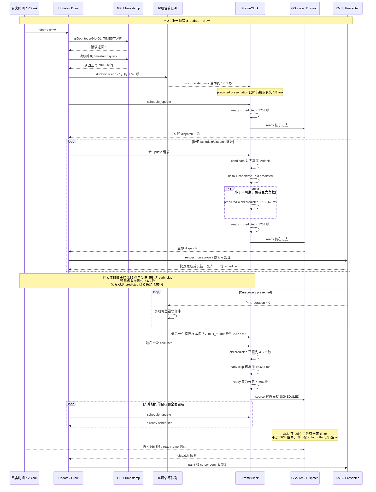

# Mutter 错误 GPU Render Time 导致鼠标延迟和整屏长时间冻结

## 1. 结论

Debian 12 / Mutter 43.8 中，驱动返回了无效的 `GL_TIMESTAMP` 起始值 `1`，但结束 timestamp query 返回正常 GPU 时间。Cogl 直接执行减法后得到约 `1748–2384 秒`的伪 GPU rendering duration。

这个伪造的超大 render time 造成两个连续阶段：

1. **快速 dispatch 阶段**：`ready_time = predicted_presentation - max_render_time` 长期落在当前时间之前，CPU 不再按刷新周期等待，反复提前 dispatch。
2. **长时间冻结阶段**：快速循环反复触发 early-presented 分支，使 `next_presentation_time_us` 每次增加一个刷新周期并逐渐领先现实；当 16 项估算队列中的错误样本被 cursor-only 的零样本淘汰后，`max_render_time` 突然恢复正常，已经积累的预测领先立即变成未来 timer。此时鼠标和桌面更新都只能得到 `already-scheduled`，GLib 停在 `poll()` 中等待 timer 到期。

因此：

> 错误 render time 本身负责破坏 dispatch 节拍；反复执行的 early-presented 分支负责积累预测偏移；估算队列恢复正常的瞬间负责把隐藏偏移转换成数秒甚至更长的整屏冻结。

驱动修复是根本方案。对 Mutter 43 的推荐防御方案，是在错误 GPU duration 写入 FrameClock 的估算队列之前，用 CPU 实际经过时间检查该 duration 是否物理上可能成立；不建议只给 early-presented 条件简单增加 `delta > 0`。

## 2. 关键代码路径

### 2.1 错误 GPU 起始时间

Cogl 从驱动读取当前 GPU 时间：

```c
GE (context, glGetInteger64v (GL_TIMESTAMP, &gpu_time_ns));
```

源码位置：`cogl/cogl/driver/gl/cogl-util-gl.c`，函数 `cogl_gl_get_gpu_time_ns()`。

问题驱动在这里返回 `1`。

### 2.2 直接计算 GPU rendering duration

```c
gpu_time_rendering_done_ns =
  cogl_context_timestamp_query_get_time_ns (info->context,
                                            info->timestamp_query);

return gpu_time_rendering_done_ns -
       info->gpu_time_before_buffer_swap_ns;
```

源码位置：`cogl/cogl/cogl-frame-info.c`，函数 `cogl_frame_info_get_rendering_duration_ns()`。

当起始值是 `1`、结束值来自正常 GPU 时钟时，两个绝对 timestamp 不再构成有效区间，于是差值接近 GPU 时钟从启动以来的总运行时间，而不是一帧的渲染时间。

### 2.3 错误值进入 16 项估算队列

```c
swap_to_rendering_done_us =
  frame_info->gpu_rendering_duration_ns / 1000;

estimate_queue_add_value (&frame_clock->swap_to_rendering_done_us,
                          swap_to_rendering_done_us);
```

源码位置：`clutter/clutter/clutter-frame-clock.c`，函数 `clutter_frame_clock_notify_presented()`。

FrameClock 从队列中取最大值：

```c
max_swap_to_rendering_done_us =
  MAX (max_swap_to_rendering_done_us,
       frame_clock->swap_to_rendering_done_us.values[i]);
```

最终：

```c
max_render_time_us =
  max_dispatch_to_swap_us +
  MAX (max_swap_to_rendering_done_us, max_swap_to_flip_us) +
  frame_clock->vblank_duration_us +
  clutter_max_render_time_constant_us;
```

源码位置：`clutter/clutter/clutter-frame-clock.c`，函数 `clutter_frame_clock_compute_max_render_time_us()`。

### 2.4 超大 max render time 使 dispatch 立即到期

```c
next_update_time_us =
  next_presentation_time_us - max_render_time_allowed_us;
```

源码位置：`clutter/clutter/clutter-frame-clock.c`，函数 `calculate_next_update_time_us()`。

正常 60 Hz 示例：

```text
next presentation 距离现在：约 16.667 ms
max render time：             约 14.583 ms
ready time：                  约 2.084 ms 后
```

故障示例：

```text
next presentation 距离现在：约 16.667 ms
max render time：             约 1753 秒
ready time：                  约 1753 秒前
```

GLib 发现 source 已经过期，schedule 后马上调用一次 dispatch。这里不是一个 GSource 自己无限自旋，而是下面的链条不断重新建立 source：

```text
schedule → 立即 dispatch → frame 完成/presented/idle
         → 新 update 请求 → 再次 schedule → 再次立即 dispatch
```

### 2.5 early-presented 分支积累预测偏移

```c
time_since_last_next_presentation_time_us =
  next_presentation_time_us -
  frame_clock->next_presentation_time_us;

if (time_since_last_next_presentation_time_us <
    refresh_interval_us / 2)
  {
    next_presentation_time_us =
      frame_clock->next_presentation_time_us +
      refresh_interval_us;
  }
```

源码位置：`clutter/clutter/clutter-frame-clock.c`，函数 `calculate_next_update_time_us()` 中的 early-presented 处理。

它原本用于处理异常提前的 presented event，避免连续两帧指向同一个刷新槽。正常输入下，预期比较值是一个很小的非负数。

本问题中，旧的 predicted time 一旦领先现实，新的 aligned candidate 会接近真实 VBlank，因此：

```text
delta = aligned candidate - old predicted
      = 一个很大的负数
```

负数仍然满足 `< refresh_interval / 2`，所以代码继续执行：

```text
new predicted = old predicted + 16.667 ms
```

每次真正执行 `calculate_next_update_time_us()` 并进入此分支，预测时间增加一个刷新周期。`schedule_update()` 返回 `already-scheduled` 的调用不会增加预测时间。

每轮净新增的预测领先近似为：

```text
领先增量 ≈ refresh_interval - 本轮实际经过的墙钟时间
```

## 3. 从第一个错误 draw 开始的时序图

下面把第一帧错误 GPU duration 进入队列的 update/draw 定义为 `t = 0`。此时 predicted time 仍基本正常，巨大偏差是在后续循环中产生的。



## 4. 为什么 cursor 和整个画面都会卡

### 4.1 Cursor lag

鼠标移动会持续产生 cursor update 请求，但 cursor-only 和普通 paint 共用对应 stage view 的 FrameClock 调度。

在错误 render time 存在期间：

- 调度节拍被大量立即 dispatch 打乱；
- cursor-only 也会参与 FrameClock 的 frame/presented 状态转换；
- cursor 位置请求数量不等于实际 cursor-only commit 数量；
- 多次请求可以被合并，或者在 `already-scheduled` 状态下等待同一个 source。

因此输入事件本身可能已经到达 CPU，GPU 也可能很快，但新的 cursor plane 位置没有按显示刷新节奏及时提交。

### 4.2 整屏冻结

当 `max_render_time` 从约 1753 秒突然恢复到 `2.667 ms` 时：

```text
old predicted 领先：      4.552347 s
再增加一个刷新周期：      0.016667 s
最终 predicted 领先：     4.569014 s
减去正常 max render：     0.002667 s
最终 ready 等待：         4.566347 s
```

随后 FrameClock 是 `SCHEDULED`，所以鼠标、窗口 damage、Firefox frame callback 等后续请求都只得到：

```text
already-scheduled
```

这不表示队列满，也不表示 color buffer 没有空闲；它表示“已经存在一个未来的 FrameClock source，不能再重新计算或提前安排”。CPU 最终停在 `poll()` 等待这个 timer，因此 cursor 和桌面 paint 一起冻结。

## 5. 日志证据

以下数据均直接摘自同一次 Mutter 调试记录。时间是 `CLOCK_MONOTONIC` 秒值；绝对起点没有业务含义，关键是各列之间的差值。

| 阶段 | `now` | `aligned` | `old_predicted` | `next` | `max_render` | `ready_delta` | `early_skip` |
|---|---:|---:|---:|---:|---:|---:|---:|
| 错误样本刚进入 | 939.452546 s | — | 939.441086 s | 939.474418 s | 1748.106300 s | −1748.084428 s | 0 |
| 偏移已经形成 | 约 942.687887 s | 942.707751 s | 946.691211 s | 946.707878 s | 1753.842631 s | 约 −1749.82 s | 1 |
| 队列恢复后的关键计算 | 942.805544 s | 942.807753 s | 947.357891 s | 947.374558 s | 0.002667 s | +4.566347 s | 1 |

第一条错误 GPU 样本和队列恢复数据：

| 指标 | 数值 |
|---|---:|
| 第一条 `swap2render` | 1,748,103,633 µs |
| 第一条错误样本写入后的 `bad_slots` | 1 |
| 从首次错误样本到队列恢复 | 3.351 s |
| 恢复前累计 presented | 102 |
| 其中 cursor-only presented | 61 |
| 恢复时 `bad_slots` | 0 |

该代表性故障段的事件数量：

| 事件 | 数量 |
|---|---:|
| `calculate_next_update_time_us()` | 约 473 |
| `early_skip` | 458 |
| FrameClock dispatch | 约 474 |
| Cursor update 请求 | 约 112 |
| Presented | 约 101 |

因此：

```text
458 × 16.667 ms ≈ 7.633 s 的预测虚拟推进
```

真实时间只经过约 `3.35 s`，最终观测到约 `4.55 s` 的预测领先。两者不会严格逐微秒相等，因为循环窗口、初始 phase、正常对齐和每轮实际耗时都会贡献差异。

完整记录的极值：

| 指标 | 观测值 |
|---|---:|
| 最大 `next_presentation_time_us - now_us` | 约 92.478 s |
| 最大相邻 presentation gap | 约 97.702 s |
| 任意 100 ms 窗口内最多 dispatch | 239 次 |

说明该偏移不是固定上限；错误测量持续存在并且 update 循环足够密集时，它可以累积到几十秒甚至更长。本文已经列出支持结论所需的关键数据，不依赖外部日志文件。

## 6. `disable-dynamic-max-render-time` 路径

启用：

```bash
CLUTTER_PAINT=disable-dynamic-max-render-time
```

后，FrameClock 不再使用 16 项测量队列计算 max render time，而是直接返回：

```c
refresh_interval_us * 0.875
```

60 Hz 下约为：

```text
16.667 ms × 0.875 = 14.583 ms
```

这表示 GPU 获得约 87.5% 的刷新周期完成绘制，dispatch 位于前一 VBlank 之后约 2.084 ms。它不是只给 GPU `12.5%` 时间。

如果已经有一帧在途并使用 triple buffering，代码再增加一个刷新周期，但目标 presentation 也相应后移一个周期，所以 dispatch phase 基本不变。

这条路径仍然执行 presentation 预测、early-presented 检查、VBlank guard 和 FrameClock 状态机；它只把动态测量换成固定预算。因此它可以规避错误 timestamp，但真正很慢的 GPU 更容易 miss VBlank，表现为降帧和延迟增加。

## 7. 真正 GPU 很慢时为什么不是同一种故障

真正 GPU 很慢时，测量值和物理行为一致：

```text
估算 GPU 很慢 → 提前 dispatch
实际 GPU 也很慢 → completion/presented 反馈变晚
```

真实背压会限制循环速度：

- 未完成帧达到限制后进入 `DISPATCHED_TWO` / `buffer-full`；
- FrameClock 不会在几毫秒内完成数百轮有效 calculate；
- 真实 `now_us` 会在 GPU 工作期间持续前进；
- guard 循环会跳过已经来不及赶上的 VBlank：

```c
while (next_presentation_time_us <
       now_us + min_render_time_allowed_us)
  next_presentation_time_us += refresh_interval_us;
```

所以真正的慢 GPU 主要导致 miss VBlank、降低帧率和增加输入延迟。这个 bug 的危险之处是：

```text
调度器认为 GPU 需要约 1753 秒，实际 GPU 却很快。
```

这种“估算极慢、实际极快”的矛盾破坏了正常背压。

## 8. 推荐的防御性代码

### 8.1 首选：在估算队列入口拒绝物理上不可能的 GPU duration

驱动已经修复 `GL_TIMESTAMP` 后，仍建议 Mutter/Clutter 在写入估算队列前增加一致性检查。

绝对 GPU timestamp 和 CPU monotonic timestamp 不要求处于同一个时间域，但两个时间区间可以进行物理一致性判断：在 `notify_presented()` 已经发生时，GPU rendering duration 不应明显大于“buffer swap 到当前 CPU 时刻”的实际经过时间。

推荐代码示意：

```c
swap_to_rendering_done_us =
  frame_info->gpu_rendering_duration_ns / 1000;

if (frame_info->cpu_time_before_buffer_swap_us != 0)
  {
    int64_t now_us = g_get_monotonic_time ();
    int64_t cpu_elapsed_since_swap_us =
      now_us - frame_info->cpu_time_before_buffer_swap_us;
    int64_t measurement_tolerance_us =
      frame_clock->refresh_interval_us;

    if (swap_to_rendering_done_us < 0 ||
        swap_to_rendering_done_us >
          cpu_elapsed_since_swap_us + measurement_tolerance_us)
      {
        CLUTTER_NOTE (
          FRAME_TIMINGS,
          "Ignoring invalid GPU rendering duration: "
          "gpu=%" G_GINT64_FORMAT " us, cpu_elapsed=%" G_GINT64_FORMAT " us",
          swap_to_rendering_done_us,
          cpu_elapsed_since_swap_us);

        swap_to_rendering_done_us = 0;
      }
  }
```

然后再执行现有的：

```c
estimate_queue_add_value (&frame_clock->swap_to_rendering_done_us,
                          swap_to_rendering_done_us);
```

这个方案的优点：

- `1753 秒 GPU duration` 对应 `十几毫秒 CPU elapsed` 时会立即被拒绝；
- 不污染 16 项队列，所以不会产生立即 dispatch 风暴；
- 真正耗时 1 秒的 GPU frame，其 presented callback 也会至少延迟约 1 秒，因此不会仅仅因为“很慢”而被错误拒绝；
- 保留有效的 `dispatch_to_swap` 和 `swap_to_flip` 测量；
- 不改变 GNOME 43 为 Firefox empty commit 保留的 early-presented 行为。

建议再配套一个单元测试，分别传入：

```text
GPU duration 10 ms，CPU elapsed 20 ms：接受
GPU duration 1 s，CPU elapsed 1.1 s：接受
GPU duration -1：拒绝
GPU duration 1753 s，CPU elapsed 20 ms：拒绝
```

### 8.2 不建议单独使用：简单增加 `delta > 0`

看起来最直接的修改是：

```c
if (time_since_last_next_presentation_time_us > 0 &&
    time_since_last_next_presentation_time_us < refresh_interval_us / 2)
```

它确实能阻止巨大负 delta 继续执行 `old_predicted + refresh_interval`，但不建议在 Debian 12 / GNOME 43 中作为唯一修复。

原因是 GNOME 43 曾加入这个下界，用于避免相等 prediction 多跳一个刷新周期，随后又在提交 `516ff7b7e` 中撤销。撤销说明指出：不等待下一个刷新周期可能与使用 empty commit 获取 frame event 的 Wayland 客户端形成反馈循环，Firefox 是明确受影响者之一。

相关历史：

- [GNOME Mutter MR 2486](https://gitlab.gnome.org/GNOME/mutter/-/merge_requests/2486)
- [GNOME Shell issue 6137](https://gitlab.gnome.org/GNOME/gnome-shell/-/issues/6137)

因此，单独恢复 `delta > 0` 可能修复本次预测漂移，却重新引入 GNOME 43 已知的 Firefox/Wayland frame callback 问题。

如果还需要第二层 FrameClock 防线，应采用“只有当 old predicted 明显超出允许的在途帧预测窗口时才重新锚定”的专门检查，并为 `delta == 0`、cursor 无 KMS update、Firefox empty commit、double/triple buffering 分别补齐测试，而不是简单恢复旧条件。

## 9. 修复优先级

推荐顺序：

1. **驱动根因修复**：保证 `glGetInteger64v(GL_TIMESTAMP)` 与 timestamp query result 来自一致且单调的 GPU 时间域；不可靠时不要宣告 timestamp-query 能力，或者返回无测量状态。
2. **Mutter 输入防御**：在估算队列入口拒绝与 CPU 实际经过时间明显矛盾的 GPU duration。
3. **现场规避**：启动 GNOME Shell 前设置 `CLUTTER_PAINT=disable-dynamic-max-render-time`，固定使用 `0.875 × refresh interval`。
4. **不要直接恢复 `delta > 0`**：除非同时验证 GNOME 43 Firefox empty commit 和无 KMS cursor update 场景。

## 10. 验证标准

修复后应同时满足：

- `swap2render` 与真实 GPU 工作量一致，不再出现数百或数千秒；
- `max_render_time` 保持合理，并随真实负载变化；
- `ready_delta` 不长期处于数千秒负值；
- `old_predicted - now` 不随 update 密度持续增长；
- 100 ms 内不再出现上百次 FrameClock dispatch；
- cursor-only 与普通 paint 能稳定按刷新节拍提交；
- 打开 Firefox 不再出现数秒至数十秒的 presentation gap；
- 真正 GPU 慢时允许降帧，但不能形成预测时间无界漂移。

## 11. 最终一句话总结

> 驱动把一帧的 GPU render duration 错报成 GPU 已运行的总时长，Mutter 因而把每一帧都安排成“早已应该开始”；实际 GPU 又很快，使 FrameClock 在真实刷新之间反复执行并把 predicted presentation 一周期一周期推向未来；当错误估算被队列清除时，这个隐藏的未来偏移变成一个长 timer，最终让鼠标和整个桌面一起停在 `poll()` 中等待。
